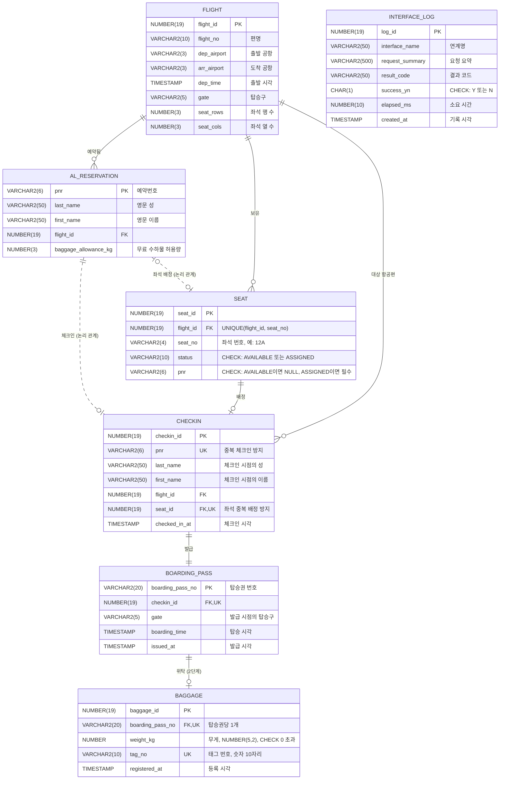

# 셀프체크인·셀프백드랍 미니 키오스크 시스템

공항 키오스크의 셀프체크인과 셀프백드랍 흐름을 작은 규모로 구현하는 개인 프로젝트입니다.

공항 셀프체크인·셀프백드랍 플랫폼과 항공사 시스템 연계 업무를 직접 만들어 보며 이해하기 위해 시작했습니다.

> 개발 중인 프로젝트입니다. "작성 예정" 항목은 기능을 구현하면서 채웁니다.

## 기술 스택

| 구분 | 사용 기술 |
|---|---|
| 언어 | Java 17 |
| 프레임워크 | Spring Boot 4.0.10 |
| DB 접근 | MyBatis Spring Boot Starter 4.0.1 (XML 매퍼) |
| DB | Oracle AI Database 26ai Free (23.26.4, 컨테이너) |
| 테스트 DB | H2 (`MODE=Oracle`) |
| 빌드 | Gradle - Groovy |
| 화면 | HTML, CSS, Vanilla JS |
| 테스트 | JUnit 5, Mockito, Spring Boot Test |

## 개발 방식

Claude Code를 보조 도구로 사용했습니다. 요구사항 정의, 설계 결정, 코드 검토, 테스트 확인은 직접 하고, 모든 코드는 직접 설명할 수 있는 범위로만 반영합니다.

## 실행 방법

준비물: JDK 17, Docker 실행 환경(OrbStack 또는 Docker Desktop)

1. 환경 변수 파일을 만들고 `change_me`를 원하는 비밀번호로 바꿉니다.

   ```bash
   cp .env.example .env
   ```

2. Oracle을 실행하고 준비될 때까지 기다립니다. 처음에는 이미지를 내려받아 시간이 걸립니다.

   ```bash
   docker compose up -d --wait
   ```

3. 애플리케이션을 실행합니다. 접속 주소는 `http://localhost:8080`입니다.

   ```bash
   ./gradlew bootRun
   ```

테스트는 H2로 실행하므로 Oracle과 `.env`가 없어도 됩니다.

```bash
./gradlew test
```

- **애플리케이션을 재시작하면 데이터가 초기화됩니다.** 시작할 때마다 `schema.sql`과 `data.sql`로 테이블을 다시 만들며, 출발 시각도 시작한 시각을 기준으로 다시 계산합니다.
- `docker compose down`은 Oracle을 종료하고, `docker compose down -v`는 DB 데이터까지 지웁니다.
- DB 비밀번호는 처음 실행할 때 정해집니다. 나중에 `.env`의 비밀번호를 바꾸려면 `docker compose down -v` 후 다시 실행합니다.

## 주요 기능과 흐름

### 예약 조회

1. 시작 화면에서 [셀프체크인]을 누르고 예약번호와 영문 성을 입력합니다.
2. 키오스크 서버가 가상 항공사 API를 HTTP로 호출해 예약과 항공편을 확인하고, 호출 결과를 연계 로그에 남깁니다.
3. 이미 체크인했는지, 체크인 가능 시간(출발 24시간 전 ~ 1시간 전)인지 차례로 확인합니다.
4. 체크인할 수 있으면 예약 정보를 보여 줍니다. 체크인 시작 전이면 시작 시각을, 마감 후면 항공사 카운터 문의를 안내합니다.

좌석 선택, 탑승권 발급, 셀프백드랍은 작성 예정입니다.

## ERD



- 실선은 DB의 외래 키(FK), 점선은 FK 없이 값으로만 연결되는 논리 관계입니다.
- `AL_RESERVATION`은 가상 항공사, `FLIGHT`는 공용, 나머지는 키오스크의 테이블입니다.
- `INTERFACE_LOG`는 다른 테이블과 관계없이 연계 기록만 쌓습니다.
- `NUMBER` 타입 PK는 Oracle SEQUENCE로 생성합니다.

### 설계 결정

| 결정 | 이유 |
|---|---|
| `CHECKIN`에 `last_name`, `first_name`을 저장 | 탑승권에 이름이 필요합니다. 항공사 테이블을 직접 읽지 않도록 체크인 시점의 이름을 저장합니다. |
| 키오스크 테이블의 `pnr`에는 `AL_RESERVATION` FK를 걸지 않음 | 항공사는 외부 시스템 역할이므로 FK 대신 항공사 API 조회로 예약을 확인합니다. |
| `CHECKIN`에 `UNIQUE(seat_id)` 추가 | 좌석 중복 배정은 조건부 UPDATE로 1차, DB 제약으로 2차 방어합니다. |
| `BAGGAGE`에 `UNIQUE(boarding_pass_no)` 추가 | 수하물은 탑승권당 1개라는 범위를 DB 제약으로도 지킵니다. |
| H2는 테스트에서만 사용 | Oracle 설정이 빠졌을 때 H2로 실행되지 않고 오류가 바로 드러나게 합니다. |

## API 목록

### 가상 항공사 API

외부 항공사 시스템을 대신하는 API입니다. 키오스크 서버가 HTTP로 호출합니다.

| 메서드 | 주소 | 설명 | 요청 | 응답 | 에러 |
|---|---|---|---|---|---|
| POST | /mock-airline/reservations/search | 예약 조회 (성은 대소문자 무시). 성이 주소와 접속 기록에 남지 않도록 본문으로 받음 | `{ pnr, lastName }` | `{ pnr, lastName, firstName, baggageAllowanceKg, flightId, flightNo, depAirport, arrAirport, depTime, gate }` | 400 값 누락, 404 예약 없음 |

### 키오스크 API

| 메서드 | 주소 | 설명 | 요청 | 응답 | 에러 |
|---|---|---|---|---|---|
| POST | /api/checkin/reservations/lookup | 예약 조회와 체크인 가능 여부 확인 (출발 24시간 전 ~ 1시간 전) | `{ pnr, lastName }` | `{ pnr, lastName, firstName, flightId, flightNo, depAirport, arrAirport, depTime, gate }` | 400 INVALID_INPUT, 404 RESERVATION_NOT_FOUND, 409 ALREADY_CHECKED_IN, 422 CHECKIN_NOT_AVAILABLE, 502 AIRLINE_ERROR, 504 AIRLINE_TIMEOUT |
| GET | /api/checkin/flights/{flightId}/seats | 좌석 배치도 조회 (1A~10F 행 번호 순서). 누가 앉았는지(pnr)는 응답하지 않음 | 주소의 `flightId` | `{ flightId, seatRows, seatCols, seats: [{ seatId, seatNo, status }] }` (status: `AVAILABLE` 선택 가능, `ASSIGNED` 배정됨) | 400 INVALID_INPUT, 404 FLIGHT_NOT_FOUND |

에러 응답 형식은 `{ "code": "RESERVATION_NOT_FOUND", "message": "예약을 찾을 수 없습니다. 예약번호와 성을 확인해 주세요." }`입니다. JSON이 아닌 요청은 415 UNSUPPORTED_MEDIA_TYPE, 예상하지 못한 오류는 500 INTERNAL_ERROR로 응답합니다.

## 테스트

`./gradlew test`로 실행합니다. 테스트는 Oracle 호환 모드의 H2(`MODE=Oracle`)를 쓰고, H2와 Oracle이 다르게 동작할 수 있는 검증은 실제 Oracle에서도 실행해 확인합니다.

| 검증 | 방법 | 결과 |
|---|---|---|
| 좌석 동시 선택 | 스레드 10개가 `CountDownLatch`로 동시에 출발해 같은 빈 좌석(ZZ101 8C)을 각자 다른 예약번호로 배정 요청 (`SeatConcurrencyTest`) | 성공 1건, `SEAT_ALREADY_TAKEN` 9건, 좌석에는 성공한 예약번호만 남음. H2와 Oracle AI Database 26ai Free에서 같은 결과. 조건부 UPDATE의 `status = 'AVAILABLE'` 조건을 빼면 10건 모두 성공하고 마지막 예약번호로 덮어써지는 것을 확인 |

실제 Oracle에서 실행할 때는 `.env`를 읽은 뒤 접속 정보를 환경 변수로 덮어씁니다 (테스트를 시작할 때 `schema.sql`·`data.sql`이 다시 실행되어 데이터가 초기화됩니다).

```bash
set -a; . ./.env; set +a
SPRING_DATASOURCE_URL=jdbc:oracle:thin:@//localhost:1521/FREEPDB1 \
SPRING_DATASOURCE_USERNAME=$APP_USER SPRING_DATASOURCE_PASSWORD=$APP_USER_PASSWORD \
./gradlew test --tests '*SeatConcurrencyTest' --rerun
```

## 트러블슈팅

| 날짜 | 문제 | 해결 |
|---|---|---|
| 2026-11-24 | JAVA_HOME이 잡히지 않아 Gradle JVM 오류 | JDK 홈 경로로 `JAVA_HOME`을 다시 지정 |
| 2026-11-25 | `data.sql` 추가 후 테스트에서 시퀀스를 찾지 못함 | 테스트 프로필에서 H2를 Oracle 모드로 지정 |
| 2026-11-25 | 항공사 연계가 실패해도 서버 로그에 원인이 남지 않음 | 실패 처리에 `log.warn`을 추가하고 개인정보가 들어갈 수 있는 내용은 제외 |

자세한 내용은 [docs/troubleshooting.md](docs/troubleshooting.md)에 있습니다.

## 단순화한 부분

- 항공사 시스템은 같은 애플리케이션 안의 가상 항공사 API로 대신합니다. 키오스크는 이 API를 HTTP로 호출합니다.
- 바코드 스캐너와 저울은 화면 입력으로, 프린터는 화면 표시로 대신합니다.
- 예약 1건은 승객 1명, 편도 항공편 1구간입니다.
- 실제 IATA 규격을 따르지 않습니다.
- 항공사가 주는 출발 시각에는 시간대 정보가 없습니다. 키오스크가 출발 공항에 있다고 보고, 출발 시각과 키오스크 시각을 모두 한국 시각(Asia/Seoul)으로 계산합니다.
